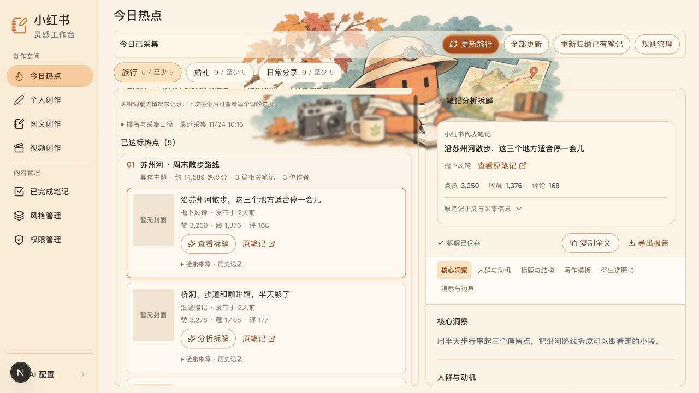
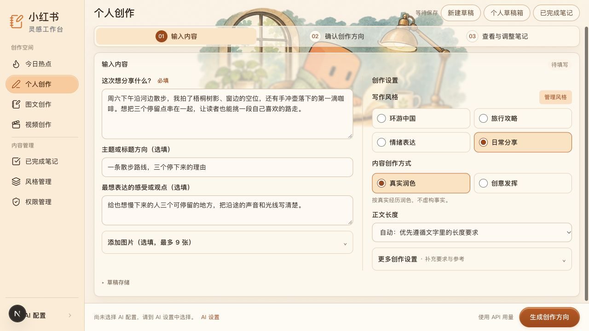
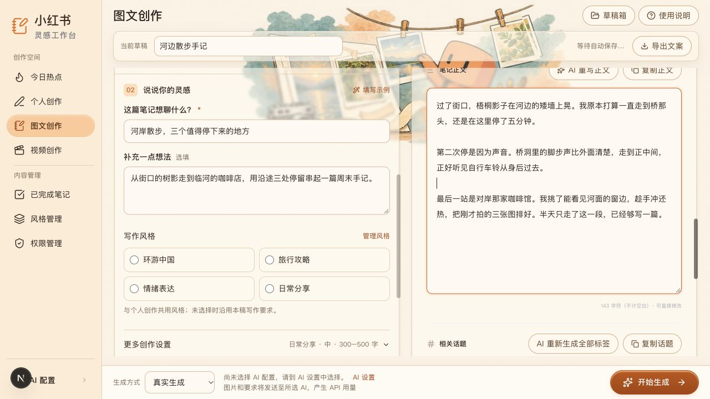
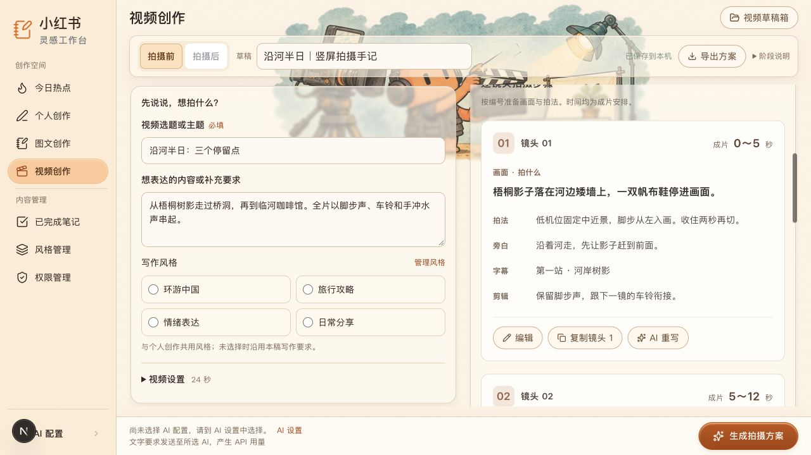

# 小红书灵感工作台

把一个选题做成一篇能编辑的笔记，或一份拿去拍摄的分镜脚本。创作者负责提供自己的素材、判断选题和确认文案，工作台负责整理输入、生成候选稿，并保留修改前后的版本供比较。

这是一款独立开发的本地 Web 应用，采用 MIT 许可证，与小红书官方无隶属关系。**真实 AI 功能由每位使用者配置自己的模型 API Key，调用费用记在自己的服务商账号上。** 初次体验可直接运行免密钥演示。

[第一次运行](#第一次运行) · [模型与热点配置](#开启真实功能) · [本机使用指南](docs/local-setup.md)

## 界面预览

### 从热点里挑一个能写的题目

在「今日热点」打开一篇代表笔记，左边看主题、互动和来源，右边拆解人群、动机与写法。从衍生选题中挑一个，就可以带入后续创作。



### 把沿路的观察写成一篇笔记

「个人创作」从自己的素材出发。这篇散步手记记下梧桐树影、桥洞回声和窗边手冲，再选择写作风格，确认想表达的感受。



### 编辑图文成稿

「图文创作」把素材要求和结果放在两栏。作者可以一边对照主题，一边修改正文、逐图配文和话题，最后导出要发布的版本。



### 把 24 秒的短片拆成四个镜头

「视频创作」把每个镜头写到可以现场执行的程度。《沿河半日》的第一个镜头占 0–5 秒，画面是河岸树影和入画的帆布鞋，下面分别写明机位、旁白、字幕和剪辑衔接。



## 可以用它做什么

| 创作环节 | 在工作台里的操作 | 得到什么 |
| --- | --- | --- |
| 找选题 | 在「今日热点」按旅行，日常等自己的账号定位去查看线索，打开参考笔记并拆解 | 笔记的人群、场景、痛点、情绪、开头和结构，以及 5 条衍生选题。可以把选定方向带入图文或视频创作 |
| 做图文 | 按发布顺序放入 1–9 张图，填写主题、篇幅与语气 | 5 个候选标题、封面文案、逐图配文、正文和话题。可直接编辑、局部重写、复制或导出 TXT |
| 写个人笔记 | 填写真实经历，选择写作风格，先确认写作方向再生成整稿 | 可继续修改的草稿。润色后先预览变化，再决定是否采用，定稿可进入「已完成笔记」 |
| 做短视频方案 | 拍摄前描述题材和条件，拍摄后填写已经拍到的镜头清单 | 拍摄前得到分镜、拍法、旁白和字幕。拍摄后得到镜头排序、转场和节奏建议，最终交付为文字方案 |
| 管理写作风格 | 在「风格管理」编辑规则，或从参考笔记提取写法，选择要吸收的部分 | 可以先试写，再决定是否将新风格用于后续创作 |

## 第一次运行

首发验证环境为 macOS 和 Node.js 24。项目声明的最低 Node.js 版本为 20.9。以下操作使用终端和 npm。[下载 Node.js](https://nodejs.org/)

```bash
git clone https://github.com/AcolasiaK/xhs-inspiration-studio.git
cd xhs-inspiration-studio
npm ci
npm run dev
```

浏览器打开 **http://127.0.0.1:3000**。也可以在 GitHub 点 **Code → Download ZIP**，解压后在含有 `package.json` 的文件夹里运行最后两条命令。开发服务运行期间保持终端打开，按 `Ctrl+C` 停止。长期在 Mac 上使用可安装随登录启动的本机服务。[本机使用指南](docs/local-setup.md)

### 免密钥体验一篇图文

1. 在首页「图文创作」点 **填写示例**，得到一个周末咖啡馆主题。
2. 上传一张 JPG、PNG 或 WebP。手边没有照片时，可以直接选仓库自带的 [collage.webp](public/illustrations/collage.webp)。
3. 保持 **演示模式**，点 **生成演示样例**。右侧会出现 5 个标题、封面、对应图片的配文、正文和话题。
4. 选一个标题，改一行正文，点 **导出文案** 或 **复制全部文案**。

演示使用固定咖啡文案，只校验图片并演示编辑、复制与导出。要根据上传的照片创作，需要配置支持图片输入的模型。

## 开启真实功能

| 想使用的功能 | 需要准备什么 |
| --- | --- |
| 模型生成、局部改写、视频策划 | 左下角 **AI 配置** 中添加自己的模型服务、API Key 和模型。可以使用 OpenAI、DeepSeek 或兼容服务。先测试文字，再在创作页选择该配置 |
| 真实识图 | 在同一配置下选择支持图片输入的模型，并通过 **测试图片理解**。可用的文字模型与可用的视觉模型取决于服务商和账号 |
| 本机热点采集、参考笔记或攻略检索 | 另行安装并启动 OpenClaw。工作台使用名为 `openclaw` 的浏览器配置，涉及小红书的页面由使用者在该浏览器完成登录和必要验证。[配置与故障排查](docs/local-setup.md) |

**数据存放和费用。** 本机版把草稿与图片存在当前浏览器的 IndexedDB，模型密钥由本机服务端保管。演示无需模型调用。选择真实生成或能力测试时，任务所需的文字或图片会发往你选定的服务商，费用按自己的 API 账号结算。笔记由创作者确认后自行发布。请使用有权处理的图片和文字。

## 查看实现与验证

项目使用 Next.js App Router、React、TypeScript 和 Zod。页面和接口位于 [app](app)，编辑器与创作界面位于 [components](components)，提示词、校验、存储及外部服务适配位于 [lib](lib)。[tests](tests) 包含业务规则与接口测试，[vendor](vendor) 随源码提供必要的本地依赖。

```bash
npm run lint
npm test
npm run build
npm run typecheck
```

服务启动后，可以在另一个终端执行 `npm run test:api`，使用合成图片验证演示接口和输入校验。单元测试使用模拟模型；性能、生成质量和服务商的实时可用性需在具体环境中单独评估。界面预览使用为展示创作流程编写的内容，热点数字只用于呈现界面布局。

## 反馈与使用权

反馈问题时请附上系统、Node.js 版本、出错页面、复现步骤和已经遮盖敏感信息的错误提示。[提交问题](https://github.com/AcolasiaK/xhs-inspiration-studio/issues)

© 2026 AcolasiaK。项目按 MIT 许可证开源，允许使用、修改、分发与商业使用。分发软件或其重要部分时，请保留版权和许可声明。第三方内容遵循各自许可证。[MIT 许可证](LICENSE) · [第三方出处与许可](THIRD_PARTY_NOTICES.md)
